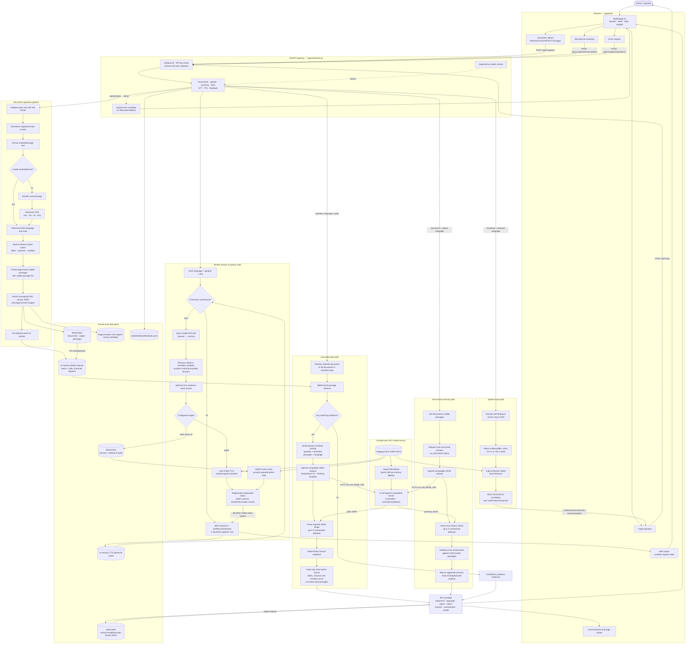

# Government GR Assistant — Model Inventory and End-to-End Architecture

## 1. Model installation status

Audit date: **19 October 2026**. Audit scope: the current Windows workstation and this repository.

**None of the models required by this application are fully downloaded on this machine.**

- There is no project `.env`, `.venvs`, `models`, or `logs` directory.
- No `vllm`, Uvicorn, or application Python process is running.
- `C:\Users\AniruddhaJoshi\.cache\huggingface\hub\models--Qwen--Qwen3-8B` exists, but contains only metadata (`refs` and `.no_exist`). It has no `snapshots` or weight blobs, so it is **not a usable downloaded model**.
- No Hugging Face cache directory exists for the application's AI4Bharat TTS or STT models.

This only proves the state of the current workstation. A separate Linux/GPU host could have the models, but no configured `LLM_BASE_URL` or running service in this workspace currently identifies such a host.

## 2. Models used by the code

| Purpose | Model/repository ID | Required by default? | How the application uses it | Normal storage after download |
|---|---|---:|---|---|
| Grounded summary and Q&A | `Qwen/Qwen3-8B` | Yes for generated answers | vLLM serves an OpenAI-compatible HTTP API; the application calls `/v1/chat/completions` | Linux: `~/.cache/huggingface/hub/models--Qwen--Qwen3-8B/`; Windows equivalent: `%USERPROFILE%\.cache\huggingface\hub\models--Qwen--Qwen3-8B\` |
| Lower-memory LLM fallback | `Qwen/Qwen3-4B` | Selected automatically when GPU memory is below the 8B threshold | Same vLLM interface | Corresponding Hugging Face cache directory |
| Speech-to-text | `ai4bharat/indic-conformer-600m-multilingual` | Yes when `STT_ENGINE=indicconformer` | Loaded in the API process by Transformers `AutoModel.from_pretrained`; converts Marathi, Hindi, or Odia audio to text | Hugging Face cache: `models--ai4bharat--indic-conformer-600m-multilingual/` |
| Text-to-speech | `ai4bharat/indic-parler-tts` | Yes when `TTS_ENGINE=parler` (default GPU script setting) | Loaded in the API process by Parler-TTS/Transformers; generates synthetic speech | Hugging Face cache: `models--ai4bharat--indic-parler-tts/` plus any referenced tokenizer/text-encoder cache |
| Consent-controlled voice cloning | `ai4bharat/IndicF5` | Optional alternative when `TTS_ENGINE=clone:<voice_id>` | Loaded only after a signed local consent record and reference audio are found | Hugging Face cache: `models--ai4bharat--IndicF5/`; voice data under `data/voices/<voice_id>/` |
| Scanned-document OCR | Tesseract `tessdata_best`: `mar`, `hin`, `ori`, `eng` | Needed for scanned pages | Local Tesseract executable and language-data files; this is OCR, not an LLM | Project GPU setup places language data in `.tools/tessdata/` |

The repository also mentions `sarvamai/sarvam-m` as an **evaluation candidate**, not the production default. Llama 3.2 is mentioned as a swappable/benchmarkable example. Neither is selected by the normal runtime configuration.

The unrelated models already present in the workstation's global Hugging Face cache (Whisper, Llama, embedding models, and others) are not referenced by this application's runtime and do not make this project model-ready.

## 3. How models are obtained and started

The models are intentionally not committed to Git. On the intended Linux/GPU host:

1. `scripts/gpu/setup.sh` creates separate application and vLLM environments.
2. `scripts/gpu/download_models.sh` calls Hugging Face `snapshot_download` for the configured LLM, Indic Parler-TTS, and IndicConformer. Gated models require `HF_TOKEN` and accepted repository terms.
3. `scripts/gpu/env.sh` examines free GPU memory. It normally selects Qwen3-8B, but selects Qwen3-4B when memory is insufficient; it also assigns the application speech models to a GPU.
4. `scripts/gpu/run_all.sh` starts vLLM on port `8001`, waits for `/v1/models`, and then starts the FastAPI application on port `8000`.
5. The API never loads the Qwen weights itself. It sends prompts over HTTP to the configured OpenAI-compatible model server. STT and TTS weights, however, are loaded directly inside the API process.

If `LLM_BASE_URL` is absent, summary and Q&A return `model_not_configured`. If the model server cannot be reached, they return `model_unavailable`. Typed document browsing and deterministic BM25 retrieval remain local. If STT or TTS is unavailable, the UI falls back to typed input or written output respectively.

## 4. Complete architecture

## 5. Output guarantees and boundaries

- A generated answer is returned only after retrieval, JSON-shape validation, citation validation, and deterministic checking of numeric/date/amount values.
- OCR spans marked unreliable cannot be used as trusted evidence for those critical values.
- The answer envelope carries the request ID, selected language, sources, uncertainty notices, status, and actual configured model name.
- Repeated summaries and questions are cached using the document content/version, language, model, and normalized question, preventing accidental reuse across changed documents or models.
- TTS is asynchronous and cached separately. It never substitutes unrelated audio on failure and always identifies generated audio as synthetic.
- The present implementation uses local BM25 retrieval. Multilingual embeddings and reranking are described as future work in the implementation plan and are not in the current runtime path.
